# SaaS 用户委托 Token 接入网关调研

日期：2026-09-15；方案三补充：2026-09-16

读者：熟悉蓝鲸网关的开发者

状态：调研与方案比较，尚未实施；尚未选择最终方案

## 1. 结论与阅读范围

本文的 **SaaS Token** 专指：bkauth 为有密钥 SaaS 客户端签发、携带真实 AppCode、代表某个用户的 OAuth Access Token。调用形式为 `Authorization: Bearer <token>`。不包含后续 `client_credentials` 应用态令牌。

三种候选方案均复用现有 Bearer、自省、audience 校验链路：

| 方案 | SaaS Token 的授权依据 | 核心取舍 |
| --- | --- | --- |
| 一：显式开启＋独立 AppCode 白名单 | 新增用户委托白名单 | 可以单独控制 Token 调用，但需维护两套授权 |
| 二：A=1、U=1 默认接受＋复用已有 AppCode 权限 | 现有网关级／资源级应用授权 | 无第二份白名单；现有授权明确覆盖这种新凭据 |
| 三：A=1、U=1 可显式开启＋复用已有 AppCode 权限 | API 开关开启后，检查现有网关级／资源级应用授权 | 默认关闭、逐 API 开放；应用仍通过原权限申请机制获权，无独立名单 |

**方案二、三都不是任意 SaaS 都能调用。** 方案二在双认证 API 上默认接受可信 SaaS Token，方案三还要求 API 显式开启；两者最终都要求其真实 AppCode 具有目标 API 权限，且用户、有效期、`aud` 校验通过。没有权限的应用需走原权限申请与审批流程；已经有有效授权的应用无需为 SaaS Token 重复申请。

如果产品接受所有双认证 API 自动增加 Token 入口，方案二最直接。如果希望 API 提供方逐个决定是否开放、同时避免第二份白名单，方案三更符合这个目标。只有需要对同一 API 的不同 SaaS 分别决定是否允许 Token、且独立于旧权限时，方案一才提供不可替代的控制能力。本文保留三个候选方案，不代替最终选型。

### 证据边界

- **bkauth 设计**：来自 [配合事项](https://iwiki.woa.com/p/4039478882) 与 [详细说明](https://iwiki.woa.com/p/4039550745)，通过 iwiki-cli 读取。两篇标注“设计阶段，实现未开始”；文中部分段落同时描述“当前字段／已有令牌”，因此不能据此断言整个 OAuth 能力均未运行。
- **网关当前代码**：Dashboard `ee3375c04b0295a06764bdba11564e2c273181c4`，APISIX `353a775e3e72671a209836f4559dd7c8eaca86e2`，以及当前本地工作区。APISIX `bkauth.lua` 有本地新增注释，未改变本次分析的执行逻辑。
- **待核验**：没有读取 bkauth 服务源码，也没有执行真实签发、自省、撤销请求。以下时序图解释文档协议，不代表已完成联调。
- **建议**：新增字段、配置、授权分支均为本次设计建议，不是现有接口。

## 2. bkauth 的角色：签发凭据，不替网关授予 API 权限

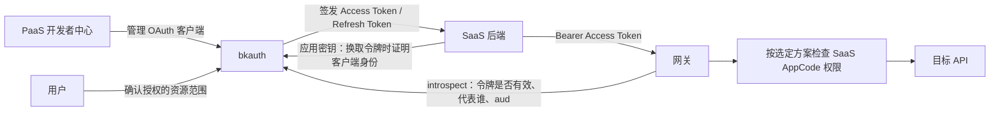

这条链路中有三件独立的事：

1. **客户端认证**：bkauth 确认换取令牌的是哪一个有密钥 SaaS。
2. **用户授权**：用户同意 SaaS 以自己的身份访问指定资源，范围进入 `aud`。
3. **API 调用授权**：网关判断这个 SaaS 是否被允许调用目标 API。

用户同意不能给未授权的 SaaS 增加网关权限；`aud` 命中也不等于 AppCode 已获授权。反过来，AppCode 有权限也不能忽略用户身份和 `aud`。资源内部的数据权限仍由相应业务／权限系统决定，不能把“用户身份有效”解释为“用户可访问所有业务数据”。

## 3. bkauth 注册的是哪种客户端

### 3.1 SaaS 后端与其桌面客户端是不同身份

依据详细文档 §3.2，设计中的注册关系如下：

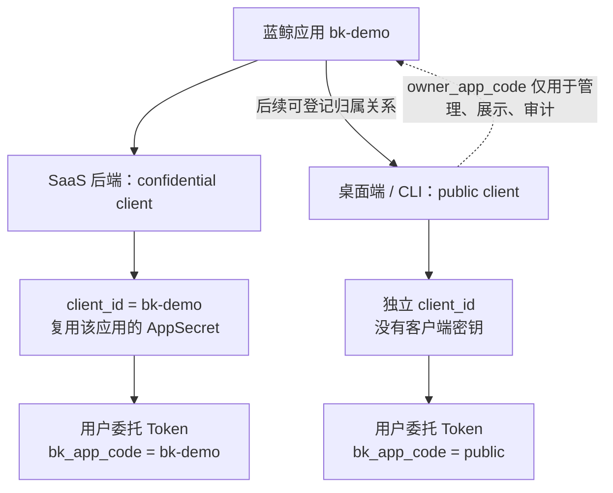

**归属于 SaaS，不等于继承 SaaS 的调用权限。** 桌面端即使由 `bk-demo` 开发，也不应借用后端 AppSecret。它拿到的 Token 仍落在 `public` 类别。

| 客户端 | 注册入口（设计） | client_id | 换 Token 时客户端认证 | 网关看到的 bk_app_code |
| --- | --- | --- | --- | --- |
| SaaS 后端 | PaaS → bkauth OpenAPI | 应用 AppCode | 使用该应用密钥 | 真实 AppCode |
| 桌面端／CLI | 首期管理员登记，后续 PaaS | 独立分配 | 无密钥 | `public` |
| 自助第三方客户端 | `/oauth2/register` | `dcr_...` | 无密钥 | `public` |
| 个人 Token | 用户管理页创建 | 文档未完整说明其自省 client_id 契约 | 不走上述换码过程 | `personal` |

PaaS 管理 OpenAPI 为 `/api/v1/apps/:bk_app_code/oauth-clients`，设计中调用方白名单仅放 `bk_paas3`。这与网关调用 introspect 的认证是两件事。

### 3.2 confidential 并不表示每次调用 API 都带密钥

这里“有密钥”指 SaaS 后端在授权服务器处能够认证自己。它不意味着网关收到 Bearer Token 后，还能验证当前持有者掌握 AppSecret。

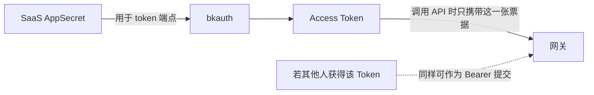

因此真实 AppCode 可以作为可信的签发归属，但不能证明这次请求一定来自原 SaaS 服务器。独立白名单不会改变这一 Bearer 属性，它只限制哪些接口接受它。

## 4. SaaS 如何取得用户委托 Token

### 4.1 授权码＋PKCE：完整时序

依据详细文档 §3.3～3.4。端点前缀为 `/realms/blueking/oauth2`，其中 realm 是 bkauth 隔离域。

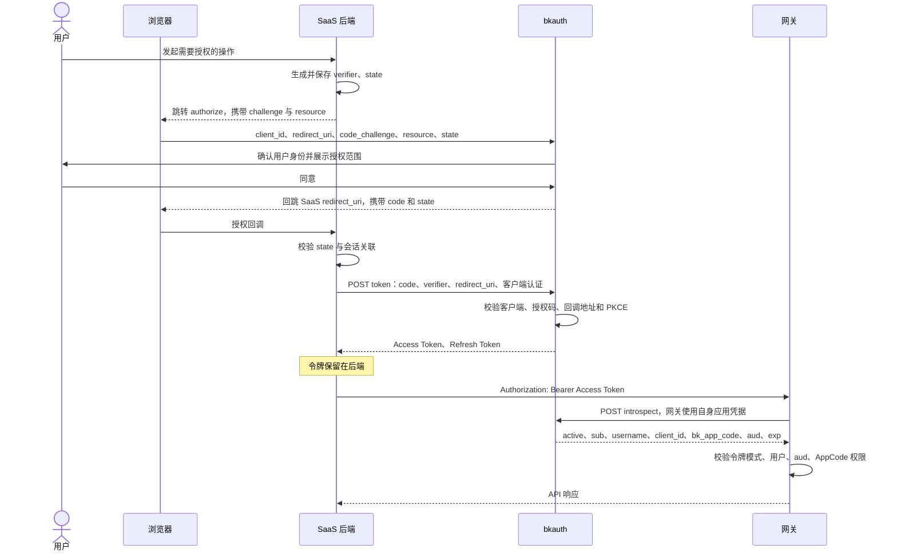

关键参数：

| 参数／机制 | 解决什么问题 | 不解决什么问题 |
| --- | --- | --- |
| `client_id` | 标识客户端 | 本身不是秘密，也不是认证证明 |
| 客户端密钥 | bkauth 在换码时验证 SaaS 身份 | 不要求每次 API 调用出示 |
| PKCE `S256` | 将授权码兑换绑定到最初生成 verifier 的一方 | 不代替 SaaS 客户端认证 |
| `state` | 将回调与发起授权的会话关联 | 不决定网关 API 权限 |
| `redirect_uri` | 约束授权码回到哪里 | 不等于客户端具有 API 权限 |
| `resource` | 请求用户同意访问的资源 | 不给 AppCode 自动授权 |

文档要求所有客户端使用 PKCE `S256`；SaaS 后端回调仅允许 HTTPS。客户端认证优先使用 `client_secret_basic`，也支持 `client_secret_post`。`grant_types` 不开放自助修改。

### 4.2 四类容易混淆的票据

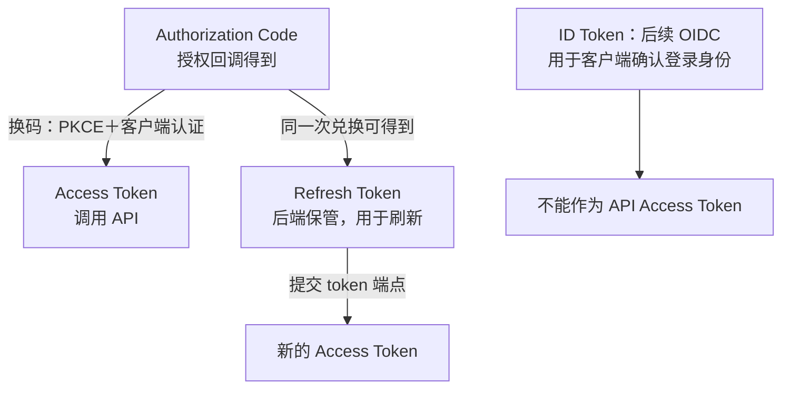

网关只消费这里的 Access Token；授权码和 Refresh Token 不应直接用于 API 调用。个人 Token 是另一种长期访问凭据，在文档的模式分类中仍归用户委托态。

### 4.3 刷新与撤销

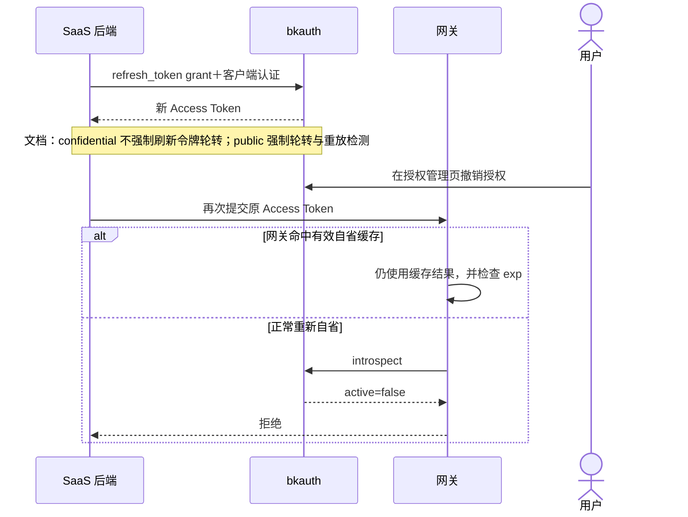

上图中的撤销范围依据文档意图；撤销授权是否同时撤销所有 Refresh Token、派生 Token，需要 bkauth 实现或联调确认。

**当前网关实现不能无条件承诺“撤销最多 5 分钟生效”。** 正常 OAuth 自省缓存 TTL 为 300 秒；`connection refused` 时可能读取 24 小时 fallback 缓存，仍受 Token 自身 `exp` 限制。权限查询也有缓存及故障降级。因此需要区分：Token 过期、bkauth 撤销授权、网关撤销 AppCode 权限，三者各自的生效链路不同。[代码依据：OAuth 缓存](../../blueking-apigateway-apisix/src/apisix/plugins/bk-cache/oauth2-access-token.lua)、[权限缓存](../../blueking-apigateway-apisix/src/apisix/plugins/bk-permission.lua)。

## 5. introspect：网关真正应理解的协议边界

### 5.1 Token 是 opaque，业务字段来自自省

文档中的 Access Token 是不透明字符串。网关不应通过字符串前缀或本地解码猜测其身份，而应信任经过认证的 bkauth introspect 响应。网关调用时使用的是**网关自身**的 `X-Bk-App-Code` / `X-Bk-App-Secret`，不是调用方 SaaS 的密钥。

下例只用于说明字段关系，不是真实 Token 响应：

```json
{
  "active": true,
  "sub": "0000000001",
  "username": "zhangsan",
  "client_id": "bk-demo",
  "bk_app_code": "bk-demo",
  "aud": ["gateway:bk-cmdb/api:list_hosts"],
  "exp": 1893456000
}
```

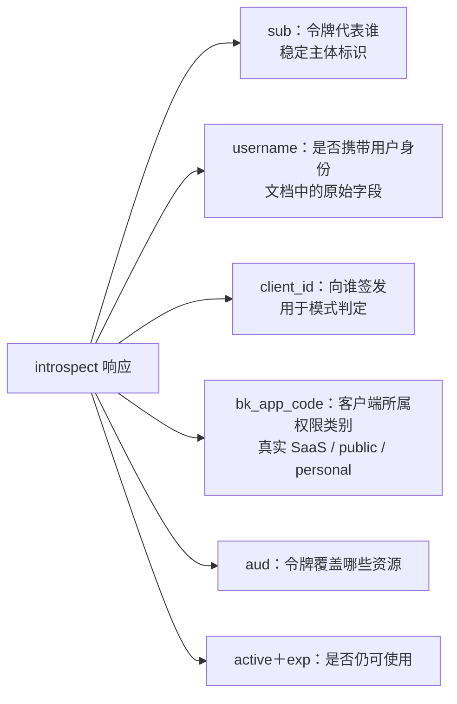

| 字段 | SaaS 用户委托态 | 应用态（后续） |
| --- | --- | --- |
| `sub` | 用户稳定 ID | 客户端 ID |
| `username` | 非空 | 空 |
| `client_id` | SaaS OAuth 客户端 ID | SaaS OAuth 客户端 ID |
| `bk_app_code` | 真实 AppCode | 真实 AppCode |
| 是否代表用户 | 是 | 否 |

**同一 AppCode 可以出现在两种模式中；真实 AppCode 不是令牌模式。**

### 5.2 双信号模式判定

这是 bkauth 文档定义的本地契约，不应推广为所有 OAuth 服务均适用的通用推断规则。

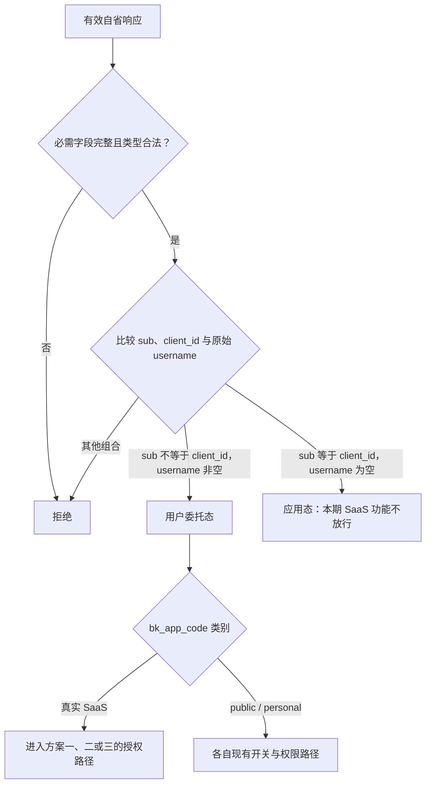

注册阶段还应保证用户 `sub` 与 `client_id` 命名空间不相交。该保证由 bkauth 实施，网关不能靠双信号校验替代注册约束。

个人 Token 的 `client_id` 是否总是存在、空 username 如何编码，需要先确认。否则将新校验应用到所有既有 Token 时可能误拒绝存量请求。

### 5.3 当前网关适配的缺口

| 原始字段 | 当前 bkauth.lua 转换结果 | 后续风险 |
| --- | --- | --- |
| `sub` | `bk_username` | 不能再用内部用户名非空推断“代表用户” |
| `username` | `bk_login_name` | 模式判定要读到这个原始语义 |
| `client_id` | 丢弃 | 无法比较 sub/client_id |
| `bk_app_code` | 保留 | 当前 AppCode 插件只放 public/personal |
| `aud` | `audience` | 已有校验可复用 |

当前 OAuth verifier 将 `app.verified` 直接设为 true，将内部 `bk_username` 非空当作用户已认证。应用态 Token 的 `sub` 同样非空，不能沿用此推断。[适配层](../../blueking-apigateway-apisix/src/apisix/plugins/bk-components/bkauth.lua)、[OAuth verifier](../../blueking-apigateway-apisix/src/apisix/plugins/bk-oauth2-verify.lua)。

### 5.4 后续能力对本期的影响边界

| 能力（文档规划） | 本期需要理解的边界 |
| --- | --- |
| `client_credentials` | 另一种模式，不能被“真实 SaaS AppCode”放行分支顺带接受 |
| 服务账号 | 文档建模为用户目录机器人，令牌模式仍是用户委托 |
| 令牌交换 | `sub` 表示主体、`act` 表示代行方；本期不必实现，但不能仅按 AppCode 推断身份 |
| OIDC | ID Token 用于登录断言，不得作为 Access Token |
| 数据权限 `scope` | 文档规划能力，不能假设当前网关已实施该维度 |
| JWT Access Token | 独立待讨论能力；不应在本期擅自将 opaque introspect 改成本地验签 |

## 6. 三方案的精确授权逻辑

### 6.1 共用前置检查

```text
确认来自 Bearer OAuth 分支
自省有效，未过期，必需字段完整
确认 user_delegation 模式
确认真实 SaaS AppCode，而非 public/personal/空值
强制有效用户，不受用户认证豁免影响
确认 aud 覆盖当前资源
执行本方案的 API 授权
```

上述步骤表示必须同时满足的条件，实际插件顺序可以沿用当前 priority 分工。

### 6.2 方案一：显式配置、独立白名单

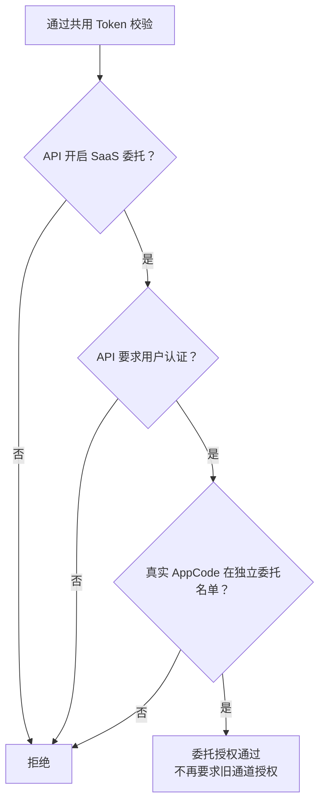

建议配置：`oauth2_saas_client_enabled=false`、`oauth2_saas_app_codes=[]`。空白名单拒绝全部 SaaS。白名单是独立授权依据，不应自动写入旧权限表。

开启条件最低要求 `U=1`。若本期只希望支持与方案二相同的接口集合，也可限制 `A=1、U=1`；原文未完整定义 `A=0、U=1` 的 SaaS 行为，实施前应明确这一项。

### 6.3 方案二：双认证默认接受、继续查旧权限

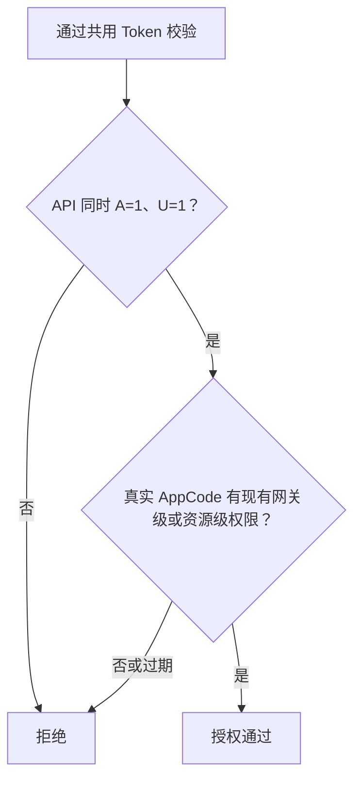

本方案明确要求查现有权限，因此直接 API 的 SaaS 委托分支即使遇到 `resource_perm_required=false`，也应查询权限；否则实现成了“无授权记录也可调用”。旧通道的该配置行为保持原状。MCP 共享入口是授权委托给 mcp-proxy 的特殊边界，见第 9 节。

### 6.4 方案三：双认证 API 显式开启、复用原权限申请机制

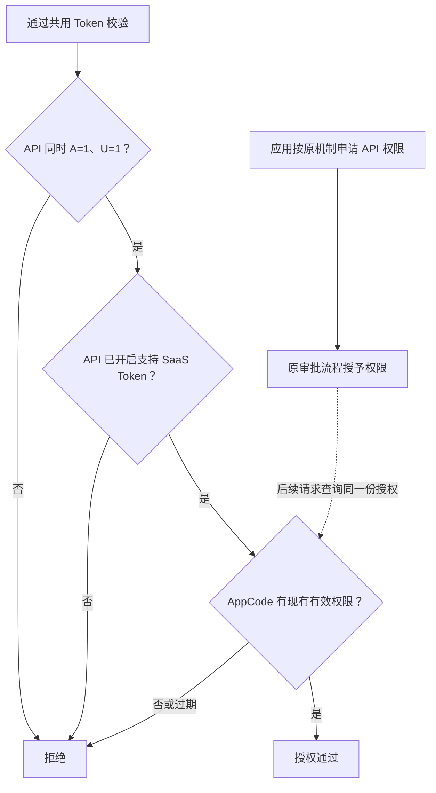

建议新增 `oauth2_saas_client_enabled`，默认 false，只允许 `A=1、U=1` 时开启。不新增 `oauth2_saas_app_codes`，不新增委托权限表，不因开启开关自动给任何应用授权。

```text
允许调用 = A=1 且 U=1
         且 API 的 SaaS Token 开关已开启
         且 Token／用户／aud 校验通过
         且真实 AppCode 具有现有有效网关级或资源级权限
```

开关控制“该 API 是否接受 SaaS 用户委托凭据”；原权限机制控制“哪个应用可以调用”。已有有效授权继续使用，未获权或授权过期的应用按原流程申请／续期；请求路径只查询权限，不自动发起申请或授予权限。

与方案二相同，直接 API 的 SaaS 委托分支强制检查 AppCode 权限，不被 `resource_perm_required=false` 短路。复用网关级授权意味着不必为每个资源重复申请，是否已有权限仍按原机制判断。

**开关是 API 级别，不是 AppCode 级别。** 开启后，所有现有及将来按原机制获权的 SaaS 都可使用 Token；关闭后，该 API 上所有 SaaS Token 调用停止，旧认证通道和权限记录保持不变。不能仅禁止其中一个应用使用 Token、同时保留该应用旧头调用能力。

### 6.5 场景对比

以下假设 API 为 A=1、U=1，用户、Token 和 aud 均有效：

| 场景 | 方案一 | 方案二 | 方案三 |
| --- | --- | --- | --- |
| 有旧授权、无独立委托授权 | 拒绝 | 允许 | 开关开启才允许 |
| 有独立委托授权、无旧授权 | 开关开启才允许 | 拒绝 | 拒绝；需按原机制获权 |
| 两种授权都没有 | 拒绝 | 拒绝 | 即使开关开启也拒绝 |
| 已有旧授权是否需重新申请 Token 权限 | 需独立配置 | 不需要 | 不需要，等待 API 开启即可 |
| 撤销旧授权 | 独立委托授权不受影响 | Token 调用随权限更新失效 | 同方案二 |
| 仅停止某 SaaS Token 调用，保留该应用旧头 | 可移出独立名单 | 本方案没有该能力 | 无单应用粒度；关闭开关会停止所有 SaaS Token |
| 停止整个 API 的 SaaS Token，保留旧头 | 关闭开关 | 无独立开关 | 关闭开关 |
| 新增双认证 API | 默认关闭委托 | 按已有权限规则默认接受；网关级授权可能已覆盖 | 默认关闭，显式开启后按已有权限规则接受 |

方案二、三不会天然扩大已有授权覆盖的 SaaS 集合，但改变现有授权所覆盖的凭据类型。方案三允许提供方逐 API 选择是否发生这一变化，仍不等同于原文的独立 AppCode 委托白名单。选用二或三都应同步修订原文的独立授权约定。

## 7. 风险与代价

| 维度 | 方案一 | 方案二 | 方案三 |
| --- | --- | --- | --- |
| 存量暴露范围 | 逐 API、逐 SaaS 显式开放 | 所有双认证 API 在配置下发后增加 Token 入口 | 逐 API 显式开放；一旦开启，对所有原机制获权 SaaS 生效 |
| 凭据泄漏 | 已开放接口上承担 Bearer 风险 | 同样承担；覆盖面通常更广 | 开启后风险与方案二相同；开关只缩小接受范围 |
| 未授权 SaaS | 由独立名单拒绝 | 由现有 AppCode 权限拒绝 | 同方案二，开关不是应用授权 |
| 授权运维 | 两份授权，可能撤销不完整 | 一份授权，两种凭据同步变化 | 一份授权加 API 开关，无需第二轮应用审批 |
| 单独禁用 Token | API 级和名单内单应用级均可 | 不支持，除非改变本方案定义 | 仅 API 级；无法只禁某个应用的 Token |
| 发布与回滚 | 名单随快照发布，回滚可能恢复旧名单 | 权限复用现有链路；入口需重新下发 | 开关随快照发布，回滚可能重新开启；权限沿用原机制 |
| 数据与 UI | 开关、迁移、名单编辑、导入导出 | 无新增 SaaS 业务配置 | 仅新增开关及其存储、迁移、配置往返，无名单编辑 |
| 运行成本 | 按开关逐步增加自省流量 | 覆盖更多 API，需估算 bkauth QPS | 可按 API 分批开启；开启接口仍需评估流量 |
| 兼容性 | 开启时检查旧认证入口 | 批量注入时检查 query/body 等旧入口 | 同方案一；默认关闭不代表开启后可省略兼容验证 |

方案三的运维风险在于将“已批准应用权限”误认为“已经开启 Token 接入”，或误认为开关只对当前申请的某个应用生效。配置页应直接说明：**开启后，所有具有本接口有效权限的 SaaS 应用均可使用用户委托 Token；关闭不回收应用权限。** 停用需要完成配置下发，不应承诺点击保存立即生效。

共同必做：严格模式识别、不被用户豁免绕过、aud 校验、过期检查、可信内部身份传递。独立白名单不能替代这些校验。

## 8. 普通 API 的具体改动

### 8.1 三方案共用：APISIX

| 文件 | 精确职责与建议逻辑 |
| --- | --- |
| [bk-components/bkauth.lua](../../blueking-apigateway-apisix/src/apisix/plugins/bk-components/bkauth.lua) | 保留原始 sub、client_id、username；保留既有用户字段映射，避免顺手改变下游身份含义 |
| [bk-oauth2-verify.lua](../../blueking-apigateway-apisix/src/apisix/plugins/bk-oauth2-verify.lua) | 校验 active/exp/字段，识别模式，写可信请求上下文；不把非空 sub 一律映射为用户已认证 |
| [bk-auth-validate.lua](../../blueking-apigateway-apisix/src/apisix/plugins/bk-auth-validate.lua) | SaaS 委托分支检查端点条件，强制有效用户；不受免用户认证名单／skip 配置绕过 |
| [bk-oauth2-appcode-validate.lua](../../blueking-apigateway-apisix/src/apisix/plugins/bk-oauth2-appcode-validate.lua) | 增加 support_saas；先分 public/personal，再处理非空真实 SaaS；按方案检查独立名单或继续既有权限 |
| [bk-oauth2-audience-validate.lua](../../blueking-apigateway-apisix/src/apisix/plugins/bk-oauth2-audience-validate.lua) | 复用现有资源匹配；不因 AppCode 有权而跳过 |
| [bk-oauth2-protected-resource.lua](../../blueking-apigateway-apisix/src/apisix/plugins/bk-oauth2-protected-resource.lua) | 新普通 API 路由允许无 Bearer 时继续旧链路；保留 MCP discovery 行为和旧头优先级 |
| [bk-permission.lua](../../blueking-apigateway-apisix/src/apisix/plugins/bk-permission.lua) | 按方案选取授权结果，不能让新增分支隐式受旧权限短路影响 |

建议保留 `app.verified` 现有兼容用途，新增可信 `credential_source`／`oauth2_mode` 表达模式，由资源校验明确解释端点接受条件。直接把所有用户委托 app.verified 改成 false，会影响共享校验、JWT 消费等路径；如果要重新定义该字段，需要另外做完整兼容改造。

**旧入口兼容有实际代码依据。** protected-resource 当前在既无旧头也无 Bearer 时直接 401；[bk-auth-verify.lua](../../blueking-apigateway-apisix/src/apisix/plugins/bk-auth-verify.lua) 在网关允许时可从 query/body 取凭据。建议新增插件参数区分缺少凭据时“继续旧流程”还是“发 OAuth challenge”，仅在新扩展的普通 API 路由使用前者。

```text
有 X-Bkapi-Authorization → 原通道优先
有 Bearer → OAuth2；无效则拒绝，不回退旧通道
两者都没有 → 新普通 API 路由继续原验证；原 MCP discovery 保持
```

### 8.2 方案一：Dashboard 配置链路

这里选取最直接的落点：白名单保存在资源配置，随资源版本发布。不引入新 core-api 权限查询 API。

| 文件 | 改动 |
| --- | --- |
| [biz/resource/models.py](../src/dashboard/apigateway/apigateway/biz/resource/models.py) | 新增开关、AppCode 列表，校验开启条件、列表合法性、排除保留身份 |
| [core/models.py](../src/dashboard/apigateway/apigateway/core/models.py) | Resource 持久化配置，新增迁移 |
| [service/contexts/resource_auth.py](../src/dashboard/apigateway/apigateway/service/contexts/resource_auth.py) | 新字段加入配置组合与剥离过程，保证快照包含真实值 |
| [biz/resource/savers.py](../src/dashboard/apigateway/apigateway/biz/resource/savers.py) | 保存开关与名单 |
| [apis/web/resource/serializers.py](../src/dashboard/apigateway/apigateway/apis/web/resource/serializers.py) | 配置读写与校验 |
| [biz/openapi/parser.py](../src/dashboard/apigateway/apigateway/biz/openapi/parser.py) | 导入／同步识别新增字段 |
| [service/resource_version/openapi_export.py](../src/dashboard/apigateway/apigateway/service/resource_version/openapi_export.py) | 导出完整保留新增配置 |
| [controller/convertor/route.py](../src/dashboard/apigateway/apigateway/controller/convertor/route.py) | SaaS 开启也注入四插件，下发名单 |
| [fixtures/plugins.yaml](../src/dashboard/apigateway/apigateway/fixtures/plugins.yaml) | 同步新增插件 schema |

还需 UI 的开关／名单编辑、发布态展示和相关 API 文档。已发布查询是否新增冗余数据库字段取决于查询需求；发布本身不要求机械复制一份名单。前端组件未展开定位。

```yaml
# 建议的 AppCode 插件配置；其余三个 OAuth2 插件照常下发
bk-oauth2-appcode-validate:
  support_public: false
  support_personal: false
  support_saas: true
  saas_app_codes:
    - bk-demo
```

名单校验成功后写入明确的授权结果，bk-permission 对本类请求采用该结果，不再查旧授权。不要将名单同步为旧 AppResourcePermission，否则会额外授予旧通道权限。

现有权限表的唯一约束没有“认证用途”维度，不能只新增一个 grant_type 就声称实现独立权限。如果后续选择“独立权限表＋审批／到期／撤销”，需要扩展管理、查询、缓存；这是本节配置名单方案之外的实现选项。

### 8.3 方案二：Dashboard 无新增业务配置

修改 [RouteConvertor._build_oauth2_plugins](../src/dashboard/apigateway/apigateway/controller/convertor/route.py)：

```python
support_saas = (
    resource_auth_config.get("app_verified_required", True)
    and resource_auth_config.get("auth_verified_required", True)
)
if not (support_public or support_personal or support_saas):
    return {}
```

下发 `support_saas`，同步插件 fixture schema。不新增 Resource 开关、名单、迁移，不改 public/personal 原有标志，不创建 SaaS 权限记录。

数据面：

```text
appcode-validate：
    SaaS 类别开启＋用户委托态＋A=1/U=1 → 继续

bk-permission（直接 API）：
    SaaS 委托 → 强制查询既有真实 AppCode 权限
    其他请求 → 保持原 resource_perm_required 行为
```

查询接口、网关级／资源级授权判断、到期处理复用原有实现。新增模式字段无需进入权限缓存键，因为这里有意让两种凭据复用同一份授权；但 JWT 等携带模式的缓存必须区分，见下节。

### 8.4 方案三：新增 API 开关，复用方案二的权限校验

相对方案一只保留开关的完整配置链路，删除独立名单及其授权分支；相对方案二，`support_saas` 不再仅由 A/U 推导，而是额外读取发布快照中的显式开关。

| 文件／边界 | 精确改动 |
| --- | --- |
| `core/models.py` 与迁移 | Resource 新增 `oauth2_saas_client_enabled`，默认 false；存量不自动开启 |
| `biz/resource/models.py` | 加入开关；开关为 true 时必须 `app_verified_required=true` 且 `auth_verified_required=true` |
| `service/contexts/resource_auth.py`、`biz/resource/savers.py` | 将开关纳入统一字段集合，保存并合入认证配置快照 |
| `apis/web/resource/serializers.py` | 读写开关，更新时按合并后的最终 A/U/开关校验，不能只检查 PATCH 中出现的字段 |
| `biz/openapi/parser.py`、`service/resource_version/openapi_export.py` | 新增建议字段 `oauth2SaasClientEnabled`；历史快照／旧导入默认关闭，按原完整同步与部分更新语义处理缺省值 |
| `controller/convertor/route.py` | 根据 A/U 与已发布开关下发 `support_saas`；任一 OAuth 类别开启才注入四插件 |
| `fixtures/plugins.yaml`、APISIX 插件 schema | 增加 `support_saas` 默认 false，不增加名单参数 |
| 发布态展示、配置页、同步接口文档 | 展示并传递同一开关；UI 仅双认证允许开启，无 AppCode 名单编辑；后端校验不能依赖 UI |
| `bk-oauth2-appcode-validate.lua`、`bk-auth-validate.lua` | 检查显式开启、A/U、真实 SaaS 及用户委托态，不把开关当成最终授权 |
| `bk-permission.lua` | 与方案二相同，直接 API 的 SaaS 委托强制查现有 AppCode 权限及有效期 |

上表相对文件路径与 §8.1～8.3 相同。发布态若需持久化检索开关，按现有 ReleasedResource 字段／序列化模式补齐；不新增独立应用授权字段。现有权限申请、审批、续期、回收、core-api 权限查询不增加第二种用途记录，也不因保存开关产生授权副作用。

建议下发逻辑：

```python
support_saas = (
    resource_auth_config.get("oauth2_saas_client_enabled", False)
    and resource_auth_config.get("app_verified_required", True)
    and resource_auth_config.get("auth_verified_required", True)
)
if not (support_public or support_personal or support_saas):
    return {}
# 四插件沿用原组合；AppCode 插件新增 support_saas，不下发名单。
```

配置修改时，如果仍保持 SaaS 开关为 true 却关闭 A 或 U，应拒绝这个不一致配置，要求同时关闭 SaaS 开关。转换时仍按三个条件取交集，数据面再校验端点条件，避免异常历史配置放行。

关闭后发布时，若 public/personal 仍开启，保留四插件但 `support_saas=false`，确保 SaaS 不被其他类别开关误放行。若三类全关，按现有组合生成规则移除自动注入的 OAuth 插件。本文开关控制网关是否将 Bearer 作为 SaaS 凭据接受，不意味着禁止后端自有的 Authorization 协议。

**开关与权限的生效路径不同：** 开关需进入资源版本并发布到数据面；权限仍按原权限服务及缓存刷新。关闭开关不删除权限，重新开启后仍有效的旧授权继续生效；回滚到开启版本可能恢复 Token 入口，应在发布／回滚检查中明确。

## 9. MCP：共享入口、单 Server 授权与第二跳

只保留本次设计相关的现状：共享 MCP 用户态入口已启用四插件，`A=1/U=1/resource_perm_required=false`；单 Server 权限由 mcp-proxy 查询 MCPServerAppPermission，工具调用使用虚拟应用权限。不要把共享入口当成普通 API 强制查询其资源权限。

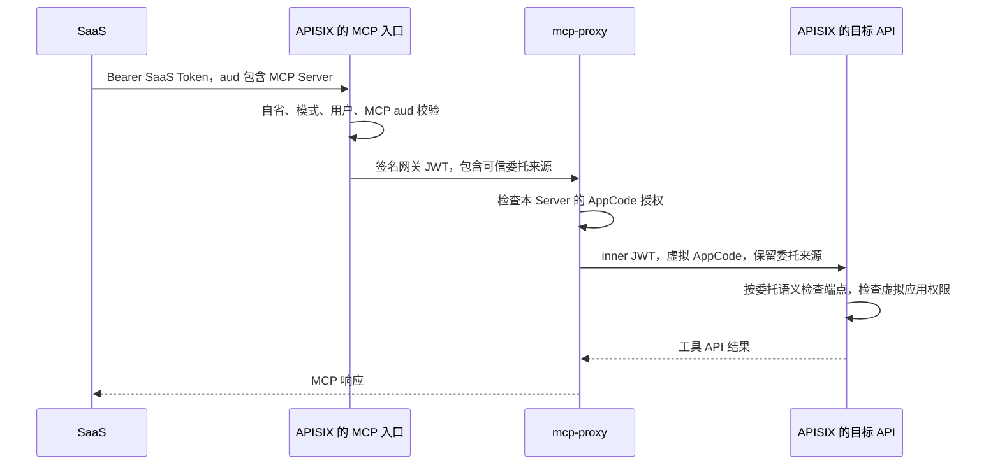

方案三目前由用户提出的范围是 API；若也要推广到 MCP，下面作为对应扩展设计，不代表已决定纳入本期。仅在共享 MCP 路由增加开关无法实现逐 Server 开放，需要单 Server 的开关消费链。

| 部分 | 方案一 | 方案二 | 方案三（若覆盖 MCP） |
| --- | --- | --- | --- |
| 共享入口 | 允许 SaaS 类别；具体名单不能在共享路由按单 Server 下发 | 同左 | 共享用户态入口允许 SaaS，具体 Server 开关留给 mcp-proxy 检查 |
| 单 Server | 新增开关和独立委托名单 | 用户态入口默认接受，复用已有 MCPServerAppPermission | 新增默认关闭的 SaaS 开关，复用原 MCP 权限申请与记录，无名单 |
| 权限中间件 | 按可信凭据来源选择授权集合 | 沿用既有 AppCode/Server/过期检查 | SaaS 委托先查 Server 开关，再查原 AppCode/Server/过期信息；旧头不受新开关影响 |
| 虚拟权限同步 | 纳入独立名单；若共用虚拟 AppCode，从两份有效授权维护，避免误删 | 复用现有同步 | 复用现有同步；开关关闭不删除原 MCP 授权和虚拟权限 |

方案三的 MCP 扩展还需在 Dashboard MCP 模型／接口、mcp-proxy Server 模型与缓存中传递开关；不能仅改普通 API RouteConvertor。该开关按 MCP 配置加载／缓存链生效，与普通 API 资源版本发布不是同一条链，应分别验证停用延迟。

方案一把新名单写进原 MCPServerAppPermission 会同时影响旧头调用，不能实现真正独立。下游不应要求原始 SaaS AppCode 另获工具 API 直连权限，也不应把 `mcp:xxx` 的 aud 重新当作工具 API aud 检查；沿用受信任 MCP 转发与虚拟权限边界。

### 内部身份的具体改动位置

| 文件 | 改动 |
| --- | --- |
| [bk-jwt.lua](../../blueking-apigateway-apisix/src/apisix/plugins/bk-jwt.lua) | 网关 JWT 增加可信来源／模式，缓存键包含新语义 |
| [bk_gateway_jwt.go](../src/mcp-proxy/pkg/middleware/bk_gateway_jwt.go) | 验签后读取新字段，并保留到上下文 |
| [util/context.go](../src/mcp-proxy/pkg/util/context.go) | JWTClaimsForLazySigning 增加相应字段 |
| [util/jwt.go](../src/mcp-proxy/pkg/util/jwt.go) | inner JWT 继续携带委托语义 |
| [inner-jwt-verifier.lua](../../blueking-apigateway-apisix/src/apisix/plugins/bk-auth-verify/inner-jwt-verifier.lua) | 还原经签名校验的来源与模式，交给共享端点校验 |
| [MCP 权限中间件](../src/mcp-proxy/pkg/middleware/mcp_permission.go) | 方案一分授权来源；方案二复用既有记录；方案三额外检查单 Server 开关 |
| [Dashboard MCPServerHandler](../src/dashboard/apigateway/apigateway/biz/mcp_server/mcp_server.py) | 方案一补配置及虚拟权限同步；方案二、三不新增权限集合，方案三需增加开关配置传递 |

不能从可伪造的普通请求头恢复模式，也不能在所有 inner JWT 上无条件标记“用户委托”。旧 JWT 缺少新字段的兼容策略需配合升级顺序明确，不能把未知来源一律当成新委托令牌。

**新 OAuth 直连策略与可信 MCP 转发策略应分开。** 不要因为第二跳目标 API 没开启“直连接受 SaaS Bearer”，就自动拒绝已获 MCP 授权的工具调用；但纯应用态目标接口仍应拒绝已确定的用户委托来源。

## 10. 上线与回归验证

### 升级顺序

1. 确认 bkauth 实际 introspect 契约，特别是个人 Token、空字段、真实 SaaS 归属与模式判据。
2. 先部署支持新配置／身份字段的数据面；如果覆盖 MCP，先让 JWT 消费链兼容新字段，再开启生产者及入口。
3. 更新 Dashboard 下发逻辑和配置 schema。
4. 重新转换、下发相关路由；改转换器不会自动改写已有 APISIX 配置。方案二可使用已有资源版本重新下发；方案三升级后默认关闭，需要提供方配置开启、生成版本并发布，不批量打开存量 API。
5. 用有权／无权 SaaS、有效／无效 audience、旧调用入口完成联调，再扩大下发范围。

不需要把 client_credentials、OIDC 或 AppSecret 通道下线一起纳入本期。

### 必测矩阵

| 验证点 | 预期 |
| --- | --- |
| 有旧授权，无独立名单 | 方案一拒绝；方案二通过；方案三仅显式开启时通过 |
| 有独立名单，无旧授权 | 方案一在开启时通过；方案二、三拒绝 |
| 无权但 aud 命中 | 拒绝 |
| 有权但 aud 不命中 | 拒绝 |
| 应用态 Token、字段矛盾、缺失必需字段 | 本期拒绝 |
| SaaS 用户委托访问纯应用态 API | 拒绝 |
| 用户认证豁免或 skip 命中 | 仍强制有效用户 |
| public/personal 开关关闭 | 不因 SaaS 分支开启而放行 |
| 旧头、query/body、双头并存 | 维持既有允许的调用方式及旧头优先级 |
| 直接 API resource_perm_required=false | 方案二、三仍检查 AppCode 权限 |
| MCP Server 无权／过期 | 拒绝，不以共享入口接受代替单 Server 授权 |
| MCP 转发访问纯应用态目标 | 委托语义不丢失，拒绝 |
| 同 app/user 不同来源连续请求 | JWT 缓存不串用模式 |
| Token 撤销、自身过期、bkauth connection refused | 区分正常缓存与故障降级，不作错误延迟保证 |
| 方案一删除名单后发布／回滚 | 生效范围与所发布快照一致 |
| 方案三存量／新建资源、旧版本缺失开关 | 默认关闭，不因已有 AppCode 权限自动开启 |
| 方案三 A 或 U 关闭但 SaaS 开关仍 true | 配置校验拒绝；转换与数据面不放行 |
| 方案三开关开启但未申请权限／权限过期 | 拒绝；原流程获权或续期并生效后才通过 |
| 方案三关闭后发布、重新开启、版本回滚 | 入口按快照生效；旧头及原权限记录不被删除 |
| 方案三关闭 SaaS 但 public/personal 保持开启 | 四插件仍在，SaaS 继续拒绝 |
| 方案三配置导入导出、完整同步与部分更新 | 开关不丢失，缺省值遵循对应更新契约，最终配置一致 |
| 方案三若覆盖 MCP：共享入口开、Server 开关关 | SaaS 委托拒绝；原旧头授权调用不受影响 |

本次只核对源码，没有执行这些测试。后续实现至少需要 Dashboard 路由转换、配置往返测试，APISIX Busted 与 test-nginx 认证链路测试；涉及 MCP 时还需要 JWT 透传和工具调用集成测试。

## 11. 实施前需确认的有限问题

| 问题 | 影响 |
| --- | --- |
| 独立授权、默认复用，还是显式开启后复用？ | 决定方案一／二／三及文档契约 |
| 个人 Token 是否始终带有效 client_id？原始 username 空值如何编码？ | 决定双信号校验能否直接覆盖所有既有 Token |
| bkauth 是否保证真实 SaaS AppCode 仅由对应 confidential 客户端得到？ | 决定网关分类所依赖的信任前提 |
| 方案一是否覆盖 A=0/U=1？ | 避免擅自扩大或限制端点集合 |
| 本期是否同时支持 SaaS Token 调用 MCP？ | 决定是否包含 mcp-proxy、内部 JWT、虚拟权限改造 |
| 是否保留现有故障降级缓存？ | 决定撤销保证；不是本期自动改变的策略 |

## 附录：文档与代码间需对齐的差异

- 原文规定独立委托授权；方案二、三有意复用现有授权，需改写该规定。方案三保留 API 显式开关，但不保留独立 AppCode 委托白名单。
- 原文提到 MCP 完整 URL audience；当前 audience parser 可直接识别的是 `mcp:...` 和网关 API 格式，不能假设完整 URL 已获支持。若 bkauth 实际签发 URL，需单独对齐解析／规范化契约。
- 原文描述约 5 分钟撤销延迟；当前存在故障降级缓存，应注明正常与故障路径的区别。
- 原文中“今天所有令牌均为用户委托态”与“设计未开始”的状态描述不够统一；本文不据此推断线上部署状态。
- 原文的 `username` 不等于当前网关内部 `bk_username` 字段语义，改模式判断时必须保留这一差别。
